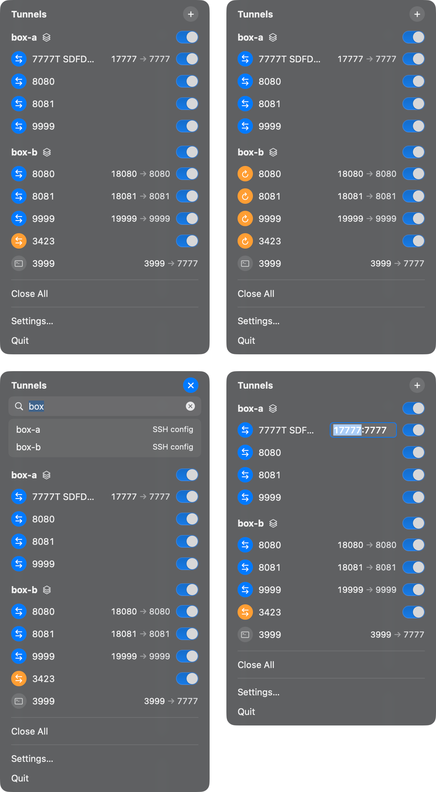

# Tunnels

A macOS menu bar app that keeps SSH port forwards open for you. Click the
icon, switch a forward on, and it stays up through sleep, Wi-Fi changes and
dropped connections.



- Uses the `ssh` you already have, the Host aliases already in
  `~/.ssh/config` (and Tailscale names), and the keys already in your agent.
  Only aliases and ports are stored.
- One connection per machine; forwards are added and removed on it without
  reconnecting. Listeners bind `127.0.0.1` only.
- Watch a whole machine and get every port it serves, each on the same local
  number. When two machines offer the same port, the second moves to an
  offset instead of failing.
- Reconnects with backoff after a drop; one notification if it gives up, one
  when the machine is back.
- Shows `ssh -L` forwards you started in a terminal, and can stop them.
- Rename, change ports, open in the browser, copy `localhost:port`: all from
  the row's right-click menu. No words on rows, nothing in the menu bar but a
  glyph.
- A single Swift package with no dependencies.

## Install

1. Download `Tunnels.app` from the
   [Releases](https://github.com/MohammedEsafi/tunnels/releases) page and
   move it to `/Applications`. macOS 14 or newer.
2. Open it the first time from a terminal. The build is signed ad hoc, so
   Finder refuses a double-click until the quarantine flag is cleared:

   ```bash
   xattr -dr com.apple.quarantine /Applications/Tunnels.app && open -a Tunnels
   ```

   After that, open it like any app, or turn on "Open at login" in its
   Settings.
3. Make sure `ssh <alias>` works in a terminal without a prompt: the alias is
   in `~/.ssh/config` and the key is loaded, for example with
   `ssh-add --apple-use-keychain ~/.ssh/id_ed25519`.
4. Click the icon in the menu bar, press ⌘N, type `alias:5432` and press
   Return. The row turns blue, and `localhost:5432` is that machine's 5432.

## Learn more

Everything else lives in the agent skills under
[`.agents/skills/`](.agents/skills): the full manual, running from source,
testing, contributing, the architecture, the security model and releasing.
Open this repository in an agent that reads skills, such as Claude Code, and
ask it in plain words: "how do I forward every port on a machine?", "run the
tests", "add a feature and open a pull request", "cut a release". The agent
loads the matching skill and answers or acts from it. The files are written
for people too, so reading them directly works just as well.

[CHANGELOG.md](CHANGELOG.md) records what changed in each version. MIT
licence, see [LICENSE](LICENSE).
